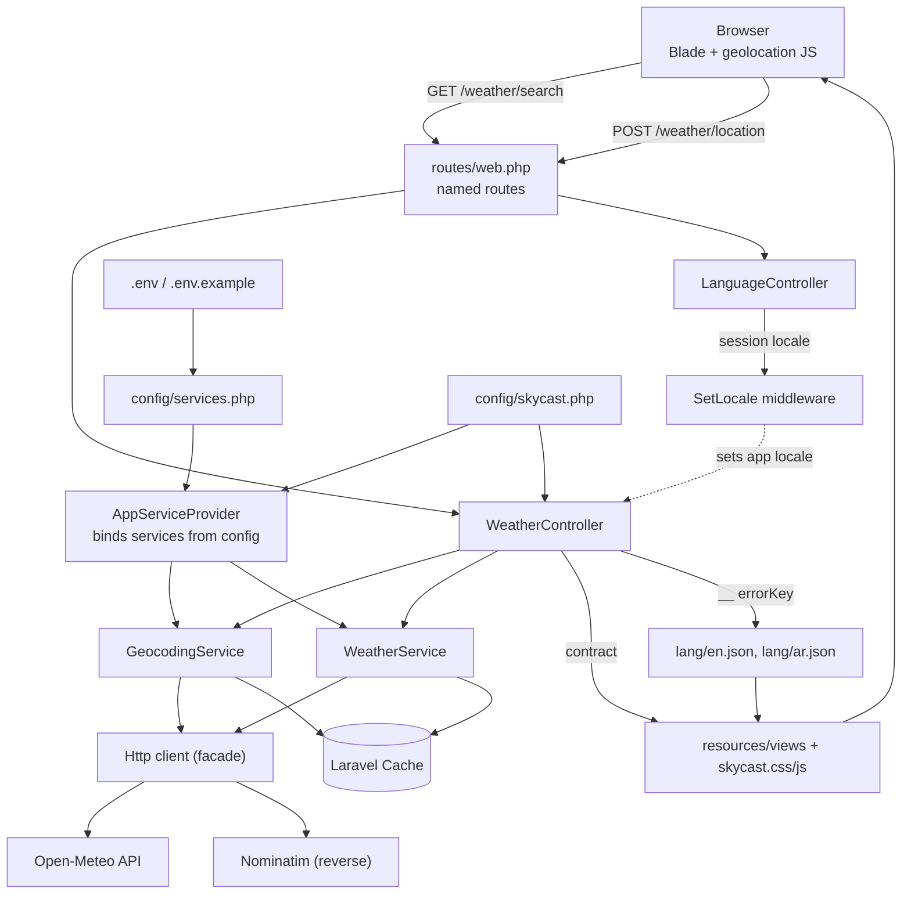

# SkyCast — Backend Implementation Guide

This document explains, file by file, how the SkyCast backend works. It
describes the code that actually exists in this repository. If the code
changes, update this guide too.

- **Framework:** Laravel 12.70 (scaffolded fresh with `composer create-project laravel/laravel:^12.0`)
- **PHP:** 8.2
- **Weather provider:** Open-Meteo (free, key-less) + Nominatim (OSM) for reverse geocoding
- **Frontend:** server-rendered Blade + a dedicated stylesheet/JS entry (`skycast.css` / `skycast.js`) built by Vite
- **Scope implemented:** backend + the real SkyCast UI. No database schema, no
  authentication, no separate internal REST API.
- **Configured plan:** none — Open-Meteo needs no API key and provides true
  hourly data, a 7-day forecast, UV index, precipitation probability, visibility
  and sun times in a single call.

---

## 1. High-level architecture

The app follows a three-layer flow:

```
Browser (Blade + JS)
   │  GET /weather/search?city=...   or   POST /weather/location
   ▼
WeatherController / LanguageController     ← validates input, builds the view contract
   ▼
GeocodingService + WeatherProvider          ← normalize, cache, handle errors, fail over
   ▼
Open-Meteo → Visual Crossing (failover)     ← server-side only; no key needed, nothing sensitive
                                              reaches the browser
```

The controller never performs HTTP itself and the services never build Blade
HTML. Each layer has exactly one job.

---

## 2. File-by-file report

### 2.1 `config/services.php` — **modified**

**Purpose.** Central place for third-party endpoints. SkyCast adds an
`open_meteo` block here.

**What was implemented.** A new `open_meteo` array was appended:

```php
'open_meteo' => [
    'forecast_url' => env('OPEN_METEO_FORECAST_URL', 'https://api.open-meteo.com/v1/forecast'),
    'geocoding_url' => env('OPEN_METEO_GEOCODING_URL', 'https://geocoding-api.open-meteo.com/v1/search'),
    'reverse_url' => env('OPEN_METEO_REVERSE_URL', 'https://nominatim.openstreetmap.org/reverse'),
    'user_agent' => env('OPEN_METEO_USER_AGENT', 'SkyCast/1.0'),
    'timeout' => (int) env('OPEN_METEO_TIMEOUT', 8),
    'connect_timeout' => (int) env('OPEN_METEO_CONNECT_TIMEOUT', 5),
    'cache' => [
        'current' => (int) env('OPEN_METEO_CACHE_CURRENT', 10),
        'forecast' => (int) env('OPEN_METEO_CACHE_FORECAST', 15),
        'geocoding' => (int) env('OPEN_METEO_CACHE_GEOCODING', 1440),
    ],
],
```

**How it works.** Laravel loads every file in `config/` at boot. `env()` is
read **only here**, at configuration load time; the rest of the app reads
values through `config('services.open_meteo.*')`. The `(int)` casts guarantee
the service constructors receive integers even if `.env` contains strings. No
key is stored because Open-Meteo requires none.

**Dependencies.** Consumed by `AppServiceProvider` (which builds the services)
and referenced by tests indirectly via `config()`.

**Why this approach.** Laravel's convention. Reading `env()` directly inside
services would break when `php artisan config:cache` is used (env is not
loaded then), so all environment access is funnelled through config. Keeping the
three endpoints (forecast, forward geocode, reverse geocode) in config means the
provider can be swapped without touching service code.

---

### 2.2 `config/skycast.php` — **created**

**Purpose.** Holds SkyCast's own allow-lists and preferences that are not
provider credentials: supported locales, supported temperature units, the
default unit, and the coordinate precision used for cache keys.

**What was implemented.**

- `locales => ['en', 'ar']`
- `units => ['metric' => ['symbol' => '°C', 'wind' => 'km/h'], 'imperial' => ['symbol' => '°F', 'wind' => 'mph']]`
- `default_units => 'metric'`
- `coordinate_precision => 2`

**How it works.** Everything that must validate or display a locale/unit reads
this file instead of hard-coding strings. Adding a unit later is a one-line
change. The `units` keys are the only values accepted from the user; the values
are forwarded to Open-Meteo's `temperature_unit` / `wind_speed_unit` parameters.

**Dependencies.** Used by `SetLocale`, `WeatherController`, `WeatherService`,
`GeocodingService` (precision) and the Blade view.

**Why this approach.** Without a single source of truth, the "supported units"
list would be duplicated across validation, the view, and the service, and the
three copies would silently drift apart.

---

### 2.3 `.env.example` — **modified**

**Purpose.** Documents every environment variable a developer must set.

**What was implemented.** The OpenWeather section was replaced with an
`OPEN_METEO_*` section, all with harmless defaults. There is **no API key**
variable, because Open-Meteo does not use one:

```
OPEN_METEO_FORECAST_URL=https://api.open-meteo.com/v1/forecast
OPEN_METEO_GEOCODING_URL=https://geocoding-api.open-meteo.com/v1/search
OPEN_METEO_REVERSE_URL=https://nominatim.openstreetmap.org/reverse
OPEN_METEO_USER_AGENT=SkyCast/1.0
OPEN_METEO_TIMEOUT=8
OPEN_METEO_CONNECT_TIMEOUT=5
OPEN_METEO_CACHE_CURRENT=10
OPEN_METEO_CACHE_FORECAST=15
OPEN_METEO_CACHE_GEOCODING=1440
```

The previous guide's `OPENWEATHER_API_KEY` (which had contained a real leaked
key) was removed entirely.

**Why this approach.** `.env.example` is committed; `.env` is not. Since there
is no secret to protect, there is nothing sensitive to leak. Applications that
must identify themselves to Nominatim do so via a User-Agent, not a key.

---

### 2.4 `app/Exceptions/WeatherException.php` — **created**

**Purpose.** One exception type that carries a **translation key** instead of a
raw message, so the controller can show a safe, localized error to the user
without leaking HTTP bodies or stack traces.

**What was implemented.**

- A `RuntimeException` subclass with a public `$errorKey` property.
- `fromStatus(int $status)`: maps a provider HTTP status to a key —
  `429 → errors.rate_limited`, `>=500 → errors.provider_unavailable`,
  `401/403 → errors.invalid_api_key` (kept for symmetry with any future keyed
  provider), everything else → `errors.provider_error`.
- `malformed(string $detail)`: for responses that arrived but are the wrong
  shape.

**How it works.** The services throw `WeatherException('errors.x')`. The value
of `$errorKey` is a key inside `lang/{en,ar}.json`. The internal message is kept
in the parent `RuntimeException` message for logs only; it is never rendered.

**Dependencies.** Thrown by `GeocodingService` and `WeatherService`, caught by
`WeatherController`.

**Why this approach.** It separates "what went wrong internally" from "what the
user may see", which is exactly the requirement not to expose internal details,
and it keeps translation lookup in one place (`__($e->errorKey)`).

---

### 2.5 `app/Services/GeocodingService.php` — **created**

**Purpose.** Convert a city name → coordinates, and coordinates → a place name.
Forward geocoding uses the Open-Meteo geocoding API; reverse geocoding uses
Nominatim (OpenStreetMap), because Open-Meteo has no reverse endpoint.

> **Update:** forward geocoding now falls back to Nominatim's search endpoint
> when Open-Meteo fails (rate limit, outage). See §8.4.

**What was implemented.**

- `resolve(string $city, string $locale): array` — calls the Open-Meteo
  geocoding endpoint with `name`, `count=5`, `language=<locale>`, `format=json`.
- `reverse(float $lat, float $lon, string $locale): array` — calls Nominatim
  (`format=jsonv2`, `lat`, `lon`, `zoom=10`, `accept-language`); returns
  coordinates with `name = null` if nothing is found (best effort).
- `normalizeResult()` — keeps entries that have `latitude`/`longitude`, uses the
  first, and records how many matched (`alternatives`). Maps Open-Meteo's
  `country`/`admin1` into `country`/`state`.
- `firstOf()` — picks the first present, non-empty label from
  `city, town, village, municipality, hamlet, county, state` for reverse lookups.
- `request()` — the single guarded HTTP call; sets a `User-Agent` (required by
  Nominatim) and an `Accept-Language` header.
- Unlike the weather service, geocoding is **not** silent about failures:
  `resolve()` throws `errors.city_not_found` when nothing matches.

**How it works.** The normalized result is:

```php
[
  'name' => 'Cairo',        // or null when the reverse lookup is unresolved
  'country' => 'Egypt',     // or a country code
  'state' => 'Cairo',
  'lat' => 30.0444,
  'lon' => 31.2357,
  'alternatives' => 3,       // how many places matched (forward only)
]
```

`resolve()` caches for **24 hours** (configurable) under
`om:geo:direct:{locale}:{md5(city)}`. `reverse()` caches under
`om:geo:reverse:{locale}:{lat}:{lon}`. Because caching happens inside
`Cache::remember`, an exception thrown inside the closure prevents caching — a
failed lookup is never stored.

**Dependencies.** `services.open_meteo.{geocoding_url,reverse_url,user_agent,timeout,connect_timeout,cache.geocoding}`,
`skycast.coordinate_precision`, `WeatherException`, the `Cache` and `Http`
facades.

**Data flow.** Controller → `GeocodingService` → provider → normalized array →
back to controller → passed to `WeatherService` as `lat`/`lon`.

**Why this approach.** Geocoding is a distinct responsibility from weather, so
it is a distinct service. Isolating it also means the two HTTP concerns (places
vs. weather) can be reasoned about and cached separately, and it keeps the
"which provider answers which question" decision in one place.

---

### 2.6 `app/Services/Providers/OpenMeteoProvider.php` — **created (later renamed)**

> **Update:** originally `app/Services/WeatherService.php`. When multi-provider
> failover was added (§8) it was renamed to `OpenMeteoProvider` and moved under
> `app/Services/Providers/`, implementing the `WeatherProvider` interface. The
> behaviour below is unchanged; it now also returns a `provider` key.

**Purpose.** Fetch and normalize current conditions and forecasts. This is the
only place that knows about Open-Meteo's response shapes and WMO weather codes.

**What was implemented.**

- A private `WMO` map: `weather_code` → `[condition category, translation key
  suffix]` (e.g. `0 => ['Clear', 'clear']`, `3 => ['Clouds', 'overcast']`,
  `95 => ['Thunderstorm', 'thunderstorm']`).
- `current(array $location, string $units, string $locale): array` — reads the
  `current` block of the shared payload.
- `forecast(array $location, string $units, string $locale): array` — builds
  the next **24 hours** from the `hourly` block (starting at the current hour)
  and the **7 daily** entries.
- `capabilities()` — what the provider can supply (stable, since Open-Meteo
  always returns true hourly + 7-day data).
- `payload()` — the single cached provider call that both `current()` and
  `forecast()` read from, so rendering a page costs **one** weather request.
- `request()` — the single guarded HTTP call.
- `describe()`, `currentHourIndex()`, `probability()`, `isoOrNull()`,
  `cacheCoordinates()` — small helpers.

**How it works.** `request()` sets `timeout` and `connectTimeout`, sends the
Open-Meteo `forecast` query (`current`, `hourly`, `daily` field lists,
`timezone=auto`, `timeformat=unixtime`, `forecast_days=7`, plus the unit
parameters derived from `$units`), checks `$response->failed()` (mapping the
status via `WeatherException::fromStatus`) and verifies the body is a JSON
array (`WeatherException::malformed` otherwise). A `ConnectionException` maps to
`errors.provider_unavailable`.

Times are requested as **UNIX timestamps (UTC)**. Every local display is derived
from the response's `utc_offset_seconds`, which is surfaced as
`timezone_offset` in the contract. `current()` also reads `visibility` and
`uv_index` from the matching `hourly` index, because Open-Meteo's `current`
block does not return them.

The single cache key includes every parameter that changes the payload:

```
om:forecast:{lat}:{lon}:{units}
```

Coordinates are rounded to 2 decimals (~1.1 km) before being used in a key, so
nearby requests share a cache entry without changing which city is reported.

Unlike the earlier OpenWeather integration, Open-Meteo provides a true 1-hour
granularity and a genuine 7-day forecast, so there is **no** "aggregate 3-hourly
entries into days" step and **no** "cap the daily list to 5 days" step. The
`capabilities` block reflects that directly:

```php
'hourly_granularity_hours' => 1,
'nominal_coverage_days' => 7,
'seven_day_forecast' => count($daily) >= 7,
```

**Honesty rule.** Nothing here invents data. Any value Open-Meteo omits (for
example, in a partial response) stays `null`, so the view can render an honest
"—" instead of a fabricated number.

**Dependencies.** `services.open_meteo.{forecast_url,timeout,connect_timeout,cache.forecast}`,
`skycast.coordinate_precision`, `WeatherException`, `CarbonImmutable`, `Cache`
and `Http`.

**Why this approach.** All provider-shape knowledge is in one class, so Blade
templates and controllers depend only on the stable contract below.

---

### 2.7 `app/Providers/AppServiceProvider.php` — **modified**

**Purpose.** Wire configuration into the two services.

**What was implemented.** In `register()`, two singletons are bound:

```php
$this->app->singleton(GeocodingService::class, fn () => new GeocodingService(...));
$this->app->singleton(WeatherService::class,   fn () => new WeatherService(...));
```

Each reads `config('services.open_meteo')` and passes plain values into the
constructor (`baseUrl`/`reverseUrl`/`userAgent`/`timeout`/`connectTimeout`/
`cacheMinutes`/`precision`).

**How it works.** When a controller asks for `WeatherService`, Laravel resolves
this closure once and reuses the instance for the request. Because it reads
`config()` lazily, tests can change `config('services.open_meteo.forecast_url')`
before making a request and the new value takes effect.

**Dependencies.** `config/services.php`, `config/skycast.php`, both services.

**Why this approach.** The services take scalar configuration, which Laravel
cannot auto-resolve, so they must be bound explicitly. Injecting configured
values also keeps `env()` out of application code.

---

### 2.8 `app/Http/Middleware/SetLocale.php` — **created**

**Purpose.** Apply the user's chosen language to every web request.

**What was implemented.** `handle()` reads `session('locale')`, validates it
against `config('skycast.locales')`, and calls `App::setLocale($locale)`. An
unknown value falls back to `config('app.locale')`.

**How it works.** Registered in the `web` group in `bootstrap/app.php`, so it
runs for every HTML request. After it runs, `__('...')` returns Arabic or
English, and `app()->getLocale()` (used by the controller) returns the active
locale, which is forwarded to Open-Meteo as the `language` parameter and drives
`dir="rtl"`/`dir="ltr"` in the layout.

**Dependencies.** `config/skycast.php` (`locales`), the session.

**Why this approach.** A single middleware keeps locale handling consistent for
all routes and avoids repeating the same lookups in each controller.

---

### 2.9 `app/Http/Controllers/WeatherController.php` — **created**

**Purpose.** Validate input, call the services, and hand the view a normalized
contract. It performs no HTTP of its own.

**What was implemented.**

- `index(Request)` — renders the home page. If the session holds a previously
  saved location it rebuilds the full contract for it (so returning visitors see
  their last city immediately); otherwise it renders the **empty contract** with
  `auto_locate = true`, which tells the browser to request the visitor's
  location. Accepts an optional `units` query value.
- `search(Request)` — validates `city` (`required|string|min:2|max:100`) and
  `units` (must be in the allow-list), resolves the city, remembers it, and
  builds the contract. If more than one place matched, it appends the
  `errors.ambiguous_city` note.
- `locate(Request)` — validates `lat` (`between:-90,90`) and `lon`
  (`between:-180,180`) plus `units`; reverse-geocodes, remembers the location,
  and builds the contract. If reverse geocoding fails, it keeps the coordinates
  and continues.
- `buildContract()` — fetches `current` and `forecast` **independently**, so a
  forecast failure never hides the current weather. Each failure is converted
  to an entry in the `errors` array via `__($e->errorKey)`. It also resolves the
  top-level `timezone_offset` (preferring the current-weather value).
- `emptyContract()` — the contract used on the home page and for early errors;
  carries the `auto_locate` flag.
- `supportedUnits()`, `persistUnits()`, `persistLocation()`, `unitsMeta()`,
  `error()` — small helpers that keep the actions short.

**How it works.** `persistUnits()` reads the requested unit (or the session
default), validates it again against the allow-list, and stores it in the
session so the choice survives navigation. `persistLocation()` stores
`{name, country, state, lat, lon}` under the session key `skycast.location` after
a successful search or geolocation, which is what lets the home page show the
last city on return visits.

**Dependencies.** `GeocodingService`, `WeatherService`, `WeatherException`,
`config/skycast.php`, the validation layer, the session.

**Why this approach.** Keeping the controller thin means the same "fetch
weather" behaviour is not duplicated between search and geolocation, and the
view contract is produced in exactly one place.

---

### 2.10 `app/Http/Controllers/LanguageController.php` — **created**

**Purpose.** Switch the interface language.

**What was implemented.** `switch(Request, string $locale)` validates the locale
against the allow-list (`abort_unless(..., 404)`), stores it in the session,
sets it on the current request, and redirects. `safeRedirect()` sends the user
back **only** when the `referer` host matches `config('app.url')`; otherwise it
goes to the home page.

**How it works.** Matching hosts avoids an open redirect: an attacker cannot
craft a link that bounces the user to an external site after switching
language.

**Dependencies.** `config/skycast.php`, `config/app.php`, the session.

---

### 2.11 `routes/web.php` — **modified**

**Purpose.** Declare the public web routes.

**What was implemented.**

| Method | URI | Name | Action | Purpose |
|---|---|---|---|---|
| GET | `/` | `weather.index` | `WeatherController@index` | Main page |
| GET | `/weather/search` | `weather.search` | `WeatherController@search` | City search (bookmarkable) |
| POST | `/weather/location` | `weather.location` | `WeatherController@locate` | Coordinates from the browser |
| GET | `/language/{locale}` | `language.switch` | `LanguageController@switch` | Change language |

The language route uses `->whereIn('locale', config('skycast.locales'))`, so an
unknown locale simply does not match (404) and never reaches the controller.

**How it works.** The home route replaced the original `view('welcome')`
closure. Search is GET so its result URL can be shared; geolocation is POST so
it carries a CSRF token (CSRF stays enabled).

**Why this approach.** Named routes let the Blade view and tests refer to
routes by name, so URL changes never break callers.

---

### 2.12 `bootstrap/app.php` — **modified**

**Purpose.** Register the middleware that SkyCast needs.

**What was implemented.** The `web` group appends `SetLocale`:

```php
->withMiddleware(function (Middleware $middleware) {
    $middleware->web(append: [SetLocale::class]);
})
```

**Why this approach.** Laravel 11+/12 configures middleware here instead of in
an `Http/Kernel.php`; this is the idiomatic place for a new web middleware.

---

### 2.13 `lang/en.json` and `lang/ar.json` — **created**

**Purpose.** Localize error messages and all UI strings.

**What was implemented.** Both files use the same keys:

- `errors.*` — one per failure mode (`city_not_found`, `invalid_api_key`,
  `rate_limited`, `provider_unavailable`, `provider_error`, `malformed_response`,
  `ambiguous_city`, `seven_day.unavailable`, …).
- `weather.*` — one per WMO category (`clear`, `mainly_clear`, `partly_cloudy`,
  `overcast`, `fog`, `drizzle`, `rain`, `rain_showers`, `snow`,
  `snow_showers`, `thunderstorm`). `WeatherService::describe()` looks these up.
- UI strings — search/language controls, the hero, the highlights cards
  (`highlights.*`), hourly/daily headings (`hourly.*`, `weekly.*`), summaries
  (`summary.*`), the About section (`about.*`), and the footer
  (`footer.*`, including the Open-Meteo attribution and privacy note).

**How it works.** `__('errors.city_not_found')` looks the key up in the JSON
file of the **active** locale (set by `SetLocale`). JSON translation files use
the key itself as the source string, so the same call returns English or Arabic.

**Why this approach.** JSON files keep the two locales side by side and require
no directory scaffolding in `lang/{en,ar}` for simple string lookups.

---

### 2.14 `lang/ar/validation.php` — **created**

**Purpose.** Arabic messages for Laravel's built-in validation.

**What was implemented.** Arabic strings for the rules this app actually uses
(`required`, `string`, `numeric`, `between`, `min`, `max`, `in`, …) plus an
`attributes` map that renames fields to `اسم المدينة`, `خط العرض`, etc.

**How it works.** When validation fails while the active locale is `ar`,
Laravel looks for `lang/ar/validation.php`; the framework already ships English
messages, so no `lang/en/validation.php` is needed.

---

### 2.15 `resources/views/` — **created**

**Purpose.** The real SkyCast UI, rendered server-side from the controller
contract.

**What was implemented.**

- `layouts/skycast.blade.php` — the page shell: `<html lang dir>`, Google Fonts
  (DM Sans + Noto Sans Arabic), and `@vite(['resources/css/skycast.css',
  'resources/js/skycast.js'])`.
- `weather.blade.php` — the whole page: header/search band, intro with a live
  "Updated …" badge, the hero, seven **Weather Highlights** (including UV
  Index), a 24-hour **Hourly Forecast** (first card = "Now"), the **7-Day
  Forecast**, sunrise/sunset + a written summary, the About section, and the
  footer (Open-Meteo attribution + privacy note).
- `components/icon.blade.php` — inline SVG icons (no icon-font/CDN).
- `components/weather-icon.blade.php` — maps a condition category (and day/night)
  to the matching icon.

**Dependencies.** The contract from `WeatherController`; `route()` for links;
`__()` for text; `config('skycast.units')`.

**Why this approach.** Server rendering keeps the first paint fast and correct
without a SPA, the layout handles RTL/LTR in one place, and a dedicated
stylesheet avoids shipping a utility framework for a single page.

---

### 2.16 `tests/Feature/WeatherTest.php` and `tests/Feature/LanguageTest.php` — **created**

**Purpose.** Prove the backend works without any real network access.

**What was implemented.** `WeatherTest` fakes all three endpoints
(`api.open-meteo.com/v1/forecast`, `geocoding-api.open-meteo.com/v1/search`,
`nominatim.openstreetmap.org/reverse`) with `Http::fake(...)` and covers: home
page, valid city search, unknown city, valid coordinates, invalid coordinates,
invalid units, malformed forecast, timeout, server error, caching, missing
optional fields, the seven-day/hourly capabilities, a full 24-hour hourly list,
and the optional detail fields (humidity, wind, visibility, pressure,
precipitation probability). `LanguageTest` covers storing a supported locale,
rejecting an unsupported one, RTL rendering, and session fallback.

**How it works.** `Http::fake([...])` intercepts every outbound request by URL
pattern; `Http::assertSent()`/`assertSentCount()`/`assertNothingSent()` verify
how many provider calls were made (this is how caching is proven — one geocode
+ one shared forecast payload = 2 calls across two requests). `TestCase` calls
`withoutVite()` so views render without built assets. Tests never need a network
connection.

**Why this approach.** Faked responses make the tests deterministic and free,
and let the suite run offline and in CI.

---

## 3. Request flows

### Scenario 0 — First visit vs. returning visit

- **Returning visitor:** the session already holds `skycast.location`, so
  `/` builds the full contract for it and shows weather immediately — no
  geolocation prompt.
- **First visit:** there is no saved location, so `/` renders the empty
  contract with `auto_locate = true`. `skycast.js` sees `data-auto-locate="1"`
  on the location button and calls `navigator.geolocation.getCurrentPosition`
  automatically (silently — a denial leaves the friendly empty hint). A granted
  location is POSTed to `/weather/location`, which then stores it in the
  session, so the next visit takes the returning-visitor path.

### Scenario 1 — Searching for a city

1. The user types a city in the GET form and submits `/weather/search?city=Cairo&units=metric`.
2. `SetLocale` sets the active locale from the session.
3. `WeatherController@search` validates `city` and `units`. An empty or invalid
   value redirects back with a validation error and **no provider call**.
4. `$validated['units']` is stored in the session.
5. `GeocodingService::resolve('Cairo', 'en')` checks its cache
   (`om:geo:direct:en:<md5>`). On a miss it calls the Open-Meteo geocoding
   endpoint, picks the first usable result, and returns
   `{name, country, state, lat, lon, alternatives}`.
6. `WeatherController::buildContract()` calls `WeatherService::current()` and
   `WeatherService::forecast()`. Both share one cached `om:forecast:...` payload;
   on a miss the service calls Open-Meteo with `lat`, `lon` and the unit
   parameters.
7. Responses are normalized, cached, and assembled into the contract (with
   `errors`, `timezone_offset` and `capabilities`).
8. `view('weather', $contract)` renders the page. `$locale` drives
   `dir="rtl"`/`dir="ltr"`.

### Scenario 2 — Using the user's location

1. The user clicks **Use my location**.
2. `resources/js/skycast.js` calls `navigator.geolocation.getCurrentPosition(...)`.
3. On success it writes `latitude`/`longitude` into the hidden POST form
   (which already holds the CSRF token) and submits it to `/weather/location`.
4. `WeatherController@locate` validates `lat ∈ [-90, 90]` and
   `lon ∈ [-180, 180]`.
5. `GeocodingService::reverse()` turns the coordinates into a name via Nominatim
   (best effort); the location is remembered in the session, then `current()`
   and `forecast()` run exactly as in Scenario 1.
6. **If permission is denied or geolocation is unavailable**, the browser
   callback shows the localized `geo.denied` / `geo.unsupported` alert and no
   request is sent. If the reverse-geocode call fails, the controller keeps the
   coordinates so weather is still shown.

### Scenario 3 — Handling a failed API request

1. Inside `WeatherService::request()`, a `ConnectionException` (timeout / DNS /
   refused) is caught and re-thrown as `WeatherException('errors.provider_unavailable')`.
2. A non-2xx response is mapped by `WeatherException::fromStatus()`:
   `429 → errors.rate_limited`, `5xx → errors.provider_unavailable`, else
   `errors.provider_error`.
3. A response that is not a JSON array, or a payload missing the required
   `current`/`hourly`/`daily` blocks, throws `WeatherException::malformed(...)`
   → `errors.malformed_response`.
4. Nothing is retried for rate-limit or provider errors.
5. `WeatherController::buildContract()` catches the exception, **does not cache
   it**, and appends `['key' => ..., 'message' => __('errors.…')]` to `errors`.
6. The user sees the localized message in a card. No HTTP body or stack trace is
   ever rendered. If only the forecast failed, the current weather is still
   shown.

---

## 4. Laravel concepts used in SkyCast

- **Routes & named routes** — `routes/web.php` defines `weather.index`,
  `weather.search`, `weather.location`, `language.switch`. Named routes let the
  view and tests reference them without hard-coding URLs.
- **Controllers** — `WeatherController` (thin: validate → services → view) and
  `LanguageController` (session + safe redirect).
- **Services & separation of concerns** — `GeocodingService` and
  `WeatherService` isolate all provider knowledge; the rest of the app never
  sees raw Open-Meteo JSON.
- **HTTP client** — `Illuminate\Support\Facades\Http` is used in `request()`
  methods, always with `timeout()` and `connectTimeout()`. Services check
  `failed()` and validate the decoded body. Geocoding adds a `User-Agent`
  (required by Nominatim).
- **Configuration via `config/services.php` + `.env`** — `env()` is read only
  in config files; the code uses `config('services.open_meteo.*')`. There is no
  secret to store, so `.env.example` documents endpoints and tuning only.
- **Cache & cache keys** — `Cache::remember()` with keys that include
  coordinates (rounded) and units, so a change in either never serves a wrong
  cached value. Failed responses are not cached. `current()` and `forecast()`
  share one payload, so a page render is a single provider call.
- **Request validation** — `$request->validate()` with explicit allow-lists
  (`Rule::in`) and numeric ranges; invalid input is rejected before any
  provider call.
- **Localization & sessions** — the locale is stored in the session and applied
  by `SetLocale`; `lang/{en,ar}.json` + `lang/ar/validation.php` provide the
  strings; the same locale is forwarded to Open-Meteo as `language`.
- **Blade data passing** — the controller passes one contract array to
  `view('weather', $contract)`.
- **Automated tests & HTTP fakes** — `Http::fake()` replaces the network with
  canned responses; `Http::assertSentCount()` proves caching; `withoutVite()`
  renders views without built assets.

---

## 5. The Blade data contract

`WeatherController` always passes these keys to the `weather` view.

```php
[
  'location' => null | [
      'city' => ?string, 'country' => ?string, 'state' => ?string,
      'lat' => float, 'lon' => float,
  ],

  'current' => null | [
      'temp' => ?float, 'feels_like' => ?float, 'humidity' => ?int,
      'pressure' => ?int, 'wind_speed' => ?float, 'wind_deg' => ?int,
      'visibility' => ?int, 'clouds' => ?int, 'uv_index' => ?float,
      'is_day' => bool,
      'sunrise' => ?string(ISO-8601), 'sunset' => ?string(ISO-8601),
      'timezone_offset' => ?int,
      'condition' => ?string, 'description' => ?string,
      'icon' => ?string, 'icon_url' => ?string, 'observed_at' => ?string,
  ],

  'hourly' => [ [
      'timestamp' => int, 'time' => string(ISO-8601),
      'temp' => ?float, 'feels_like' => ?float, 'humidity' => ?int,
      'pressure' => ?int, 'wind_speed' => ?float, 'pop' => ?float,   // 0..1
      'condition' => ?string, 'description' => ?string,
      'icon' => ?string, 'icon_url' => ?string,
  ], ... ],

  'daily' => [ [
      'timestamp' => int, 'date' => 'YYYY-MM-DD',
      'temp_min' => ?float, 'temp_max' => ?float, 'humidity' => ?int,
      'wind_speed' => ?float, 'pop' => ?float, 'uv_index' => ?float,
      'condition' => ?string, 'description' => ?string,
      'icon' => ?string, 'icon_url' => ?string,
      'sunrise' => ?string(ISO-8601), 'sunset' => ?string(ISO-8601),
  ], ... ],

  'timezone_offset' => ?int,   // seconds; drives every local-time display

  'units' => [
      'temperature' => 'metric|imperial',
      'temperature_symbol' => '°C|°F',
      'wind' => 'km/h|mph',
  ],

  'locale' => 'en|ar',
  'updated_at' => ?string(ISO-8601),

  'auto_locate' => bool,   // true only on a first-visit empty home page

  'errors' => [ ['key' => string, 'message' => string], ... ],

  'capabilities' => [
      'plan' => 'open-meteo',
      'current' => bool, 'hourly' => bool,
      'hourly_granularity_hours' => 1,
      'daily' => bool, 'daily_days' => int,
      'nominal_coverage_days' => 7,
      'seven_day_forecast' => bool,
  ],
]
```

> **Important:** the view's `errors` key holds **provider** errors (an array).
> Laravel also shares its validation bag under the name `errors`; view data
> overrides shared data, so validation messages must be read from
> `session('errors')` inside Blade (the view does this).

---

## 6. File relationship map



---

## 7. Known limitations

1. **No API key / no account.** Open-Meteo is free and key-less, so there is
   nothing to configure and nothing to leak. In exchange, the app depends on a
   public service with its own fair-use expectations; heavy traffic should use
   the caching layer (already in place) or a paid Open-Meteo plan.
2. **Reverse geocoding uses Nominatim (OSM).** It is rate-limited and asks that
   clients send a real User-Agent (`OPEN_METEO_USER_AGENT`). Reverse lookups are
   best-effort; a failure still shows weather for the coordinates.
3. **UI reloads on change.** Changing units or language performs a normal page
   navigation; there is no client-side state manager by design.
4. **No database schema was added.** Laravel's default `users`/`cache`/`jobs`
   migrations remain because the fresh scaffold created them; SkyCast uses none
   of them. Sessions use the **`cookie`** driver with a 30-day lifetime
   (`SESSION_LIFETIME=43200`), so the last location, units and language live in
   an encrypted browser cookie and survive server restarts and free-tier sleeps.
   Cache uses the `file` store.
5. **Shared-IP rate limiting on hosts like Render.** Open-Meteo applies free-tier
   limits *per IP address*, so hosting providers that share an outbound IP (Render,
   Vercel, Netlify) are throttled early and the forecast call returns HTTP 429
   (`errors.rate_limited`). Open-Meteo's terms recommend Cloudflare Workers for
   this. Deploy `cloudflare/open-meteo-proxy.js` as a Worker and set
   `OPEN_METEO_FORECAST_URL` to `https://<worker>.workers.dev/v1/forecast`. The
   Worker qualifies as a Cloudflare user, so the limit is applied per user and the
   429 disappears. No application code changes. As a second line of defence, the
   provider failover in §8 sends the same request to Visual Crossing when
   Open-Meteo answers 429.

---

## 8. Multi-provider weather with automatic failover

SkyCast talks to weather through a single interface, `App\Services\Contracts\WeatherProvider`,
so the controller never learns which provider answered. `App\Services\FailoverWeatherService`
implements that interface and tries the configured providers in order.

### 8.1 Components

| Class | Responsibility |
|---|---|
| `Contracts\WeatherProvider` | `name()`, `capabilities()`, `current()`, `forecast()` — the shape every source must honour |
| `Providers\OpenMeteoProvider` | Today's Open-Meteo logic (renamed from `WeatherService`); `name()` = `open_meteo` |
| `Providers\VisualCrossingProvider` | Visual Crossing timeline API, normalized to the identical key shape; `name()` = `visual_crossing` |
| `FailoverWeatherService` | Tries providers in order, returns the first success; `name()` = `failover` |
| `ProviderHealth` | Per-provider circuit breaker (failure counter + cooldown) backed by `Cache` |

Every provider adds a `provider` key to the arrays it returns, and the controller
copies it into the Blade contract as `provider`, so the rendered page knows which
source produced the data.

### 8.2 Failover policy

- **Order** comes from `SKYCAST_PROVIDER_ORDER` (default `open_meteo,visual_crossing`).
  A provider whose key is empty (Visual Crossing without `VISUAL_CROSSING_API_KEY`)
  is skipped entirely, so the app runs Open-Meteo-only with no configuration.
- **Triggers**: any `WeatherException` — rate limit (429), 5xx, 401/403, timeout
  (`ConnectionException`) or a malformed payload — moves to the next provider.
  A non-`WeatherException` thrown while a provider normalizes its payload (a
  provider bug) is converted to a malformed-response error, so it fails over
  instead of surfacing a 500. Gaps in a *successful* response (`null` values)
  do not trigger failover.
- **Circuit breaker**: after `SKYCAST_PROVIDER_BREAKER_THRESHOLD` consecutive
  failures (default 3) a provider is skipped for `SKYCAST_PROVIDER_BREAKER_COOLDOWN`
  minutes (default 5). A single success resets the counter. If *every* provider is
  down, the service still attempts them in order rather than leaving the user with
  no weather; if all fail, the last error surfaces through the normal error path.
- **Per request**: a provider that already failed for `current()` is not retried
  for `forecast()` in the same render, so a total outage costs one round of
  timeouts rather than two.

### 8.3 Visual Crossing mapping

- **Request**: `GET {url}/{lat},{lon}?key=...&unitGroup=metric|us&include=current,hours,days&contentType=json`.
- **Time**: hourly `datetime` and daily `sunrise`/`sunset` are **time-only** strings
  (`"12:00:00"`), so they are anchored to their day; `currentConditions.datetime`
  is a full datetime. A record's own epoch (`datetimeEpoch`, `sunriseEpoch`,
  `sunsetEpoch`, `offsetseconds`) is preferred when present. Records carry a
  `tzoffset` in hours (possibly fractional, e.g. `5.5`); each is converted to the
  underlying UTC instant, with a per-record offset (DST change) taking priority
  over the day's and the location's. `timezone_offset` is the top-level
  `tzoffset * 3600` (rounded). The 24-hour window starts at the local hour
  containing the current time, so 12:30 selects the 12:00 bucket.
- **Fields**: `temp`, `feelslike`, `humidity`, `pressure`, `windspeed`, `winddir`,
  `visibility`, `cloudcover`, `uvindex` (current); `tempmin`/`tempmax`/`uvindex`/`sunrise`/`sunset`/`precipprob`
  (daily); `temp`/`feelslike`/`humidity`/`windspeed`/`precipprob` (hourly).
  `precipprob` (0–100) becomes `pop` (0–1). `visibility` is reported in kilometres
  (`metric`) or miles (`us`) and is converted to metres to match Open-Meteo.
  Missing fields normalize to `null`.
- **Daily**: Visual Crossing defaults to 15 days; the provider trims to the 7-day
  contract with `array_slice`.
- **Icons**: Visual Crossing icons map to the same `weather.*` translation keys as
  Open-Meteo's WMO codes; unknown icons fall back to `overcast`. `-night` sets
  `is_day = false`.

### 8.4 Geocoding fallback

Forward geocoding (`GeocodingService::resolve()`) uses Open-Meteo first and, on a
provider/transport error or 429 (never on a genuine "no such city"), retries
Nominatim's search endpoint (`OPEN_METEO_NOMINATIM_SEARCH_URL`). The two results are
cached under separate keys so one Open-Meteo hiccup does not pin the fallback answer
for the whole cache lifetime. Reverse geocoding is unchanged (always Nominatim).

### 8.5 Environment

```
SKYCAST_PROVIDER_ORDER=open_meteo,visual_crossing
SKYCAST_PROVIDER_BREAKER_THRESHOLD=3
SKYCAST_PROVIDER_BREAKER_COOLDOWN=5

# Optional — enables the Visual Crossing failover provider:
VISUAL_CROSSING_API_KEY=
VISUAL_CROSSING_URL=https://weather.visualcrossing.com/VisualCrossingWebServices/rest/services/timeline
VISUAL_CROSSING_TIMEOUT=8
VISUAL_CROSSING_CONNECT_TIMEOUT=5
VISUAL_CROSSING_CACHE_FORECAST=15

# Forward-geocoding fallback endpoint:
OPEN_METEO_NOMINATIM_SEARCH_URL=https://nominatim.openstreetmap.org/search
```

**Manual step:** create a free Visual Crossing account
(<https://www.visualcrossing.com/weather-api>), copy the key, and set
`VISUAL_CROSSING_API_KEY` locally and on the Render service → **Environment** tab.
Without it the app works exactly as before (Open-Meteo only).

---

## 9. Commands and verification

> Every command below was run against this repository. Where a command was not
> run, it is stated explicitly.

**1. Install dependencies:**

```bash
composer install
npm install
```

**2. Create your environment file and key** (`.env` is not committed):

```bash
copy .env.example .env
php artisan key:generate
```

No weather API key is required.

**3. Build the front-end assets** (needed for the real UI):

```bash
npm run build
```

**4. Clear cached config/views after editing `.env` or Blade:**

```bash
php artisan config:clear
php artisan view:clear
```

**5. Run the automated tests** (no network required):

```bash
php artisan test
```

Observed result:

```
Tests:    48 passed (141 assertions)
```

**6. Format changed files with Pint:**

```bash
vendor/bin/pint
```

**7. Start the development server:**

```bash
php artisan serve
```

Then open <http://127.0.0.1:8000>. Try `/?units=imperial`,
`/weather/search?city=Cairo`, the **Use my location** button (browser will ask
for permission), and the language links.

**8. Inspect routes:**

```bash
php artisan route:list
```

### Troubleshooting

- **Weather data is blank / "—" everywhere** → Open-Meteo returned a partial
  response; check connectivity and re-run with `php artisan config:clear`.
- **"…too many requests" (429)** → rate limit; wait, or increase the cache TTLs
  in `config/services.php`.
- **Reverse geocoding fails but weather still shows** → expected (best effort);
  set a descriptive `OPEN_METEO_USER_AGENT` to comply with Nominatim policy.
- **Nothing renders / RTL wrong** → check that the language route stored the
  locale (`session('locale')`) and that `npm run build` has been run.
- **Changes to `.env` have no effect in production** → run `php artisan config:clear`
  (or `config:cache`).

---

## 10. Change tracking

| File | Action | Purpose | Status |
|---|---|---|---|
| `config/services.php` | Modified | Open-Meteo forecast/geocoding/reverse endpoints, timeouts, cache TTLs; Visual Crossing config; Nominatim search URL | Tested |
| `config/skycast.php` | Created | Supported locales, units (metric/imperial), default unit, cache coordinate precision, provider order, circuit breaker | Tested |
| `.env.example` | Modified | Document `OPEN_METEO_*` variables (no key); removed the leaked `OPENWEATHER_API_KEY` | Implemented |
| `app/Exceptions/WeatherException.php` | Created | Provider error → translation key, no leaked details | Tested |
| `app/Services/GeocodingService.php` | Created | City ⇄ coordinates (Open-Meteo + Nominatim search fallback + reverse), 24h cache | Tested |
| `app/Services/Contracts/WeatherProvider.php` | Created | Provider interface (`name`/`capabilities`/`current`/`forecast`) | Tested |
| `app/Services/Providers/OpenMeteoProvider.php` | Renamed from `WeatherService.php` | Open-Meteo current + 24h hourly + 7-day daily, WMO mapping, single cached payload, capabilities | Tested |
| `app/Services/Providers/VisualCrossingProvider.php` | Created | Visual Crossing timeline → identical normalized shape; time-only fields anchored to their day, epoch preferred, fractional tzoffset, visibility → metres, 7-day trim | Tested |
| `app/Services/FailoverWeatherService.php` | Created | Tries providers in order, first success wins; normalization crashes fail over; per-request failure memory; rethrows the last error | Tested |
| `app/Services/ProviderHealth.php` | Created | Per-provider circuit breaker (failure counter + cooldown) | Tested |
| `app/Providers/AppServiceProvider.php` | Modified | Bind geocoding + failover weather provider with config values; force https in production | Tested |
| `app/Http/Middleware/SetLocale.php` | Created | Apply session locale to each request | Tested |
| `app/Http/Controllers/WeatherController.php` | Created | Validation, orchestration, view contract | Tested |
| `app/Http/Controllers/LanguageController.php` | Created | Locale switch + safe redirect | Tested |
| `routes/web.php` | Modified | Named routes for index/search/location/language | Tested |
| `bootstrap/app.php` | Modified | Register `SetLocale` in the web group | Tested |
| `lang/en.json` | Created | English errors, `weather.*` conditions, and UI strings | Tested |
| `lang/ar.json` | Created | Arabic errors, `weather.*` conditions, and UI strings | Tested |
| `lang/ar/validation.php` | Created | Arabic validation messages + attribute names | Implemented |
| `resources/views/layouts/skycast.blade.php` | Created | Page shell, fonts, Vite entry | Tested |
| `resources/views/weather.blade.php` | Created | The full SkyCast UI (hero, highlights, hourly, 7-day, sun, about, footer) | Tested |
| `resources/views/components/icon.blade.php` | Created | Inline SVG icon set | Tested |
| `resources/views/components/weather-icon.blade.php` | Created | Condition → icon mapping (day/night) | Tested |
| `resources/css/skycast.css` | Created | Page styles | Tested |
| `resources/js/skycast.js` | Created | Geolocation + form helpers | Tested |
| `vite.config.js` | Modified | Add the `skycast.css`/`skycast.js` inputs | Tested |
| `tests/Feature/WeatherTest.php` | Created | Open-Meteo backend behaviours (incl. saved-location home + auto-locate) with `Http::fake` | Tested |
| `tests/Feature/LanguageTest.php` | Created | Locale switching and RTL/LTR behaviour | Tested |
| `tests/Feature/ProviderBindingTest.php` | Created | Container resolves the failover weather provider | Tested |
| `tests/Feature/VisualCrossingProviderTest.php` | Created | Visual Crossing normalization (time-only hours/sunrise/sunset, epoch preference, fractional tzoffset, 7-day bound, visibility conversion, missing fields) | Tested |
| `tests/Feature/FailoverWeatherTest.php` | Created | End-to-end failover: primary 429 → fallback provider answers; no key → error surfaced | Tested |
| `tests/Feature/GeocodingFallbackTest.php` | Created | Forward-geocoding fallback to Nominatim; empty result does not crash | Tested |
| `tests/Unit/ProviderHealthTest.php` | Created | Circuit breaker threshold, per-provider isolation, reset on success | Tested |
| `tests/Unit/FailoverWeatherServiceTest.php` | Created | Order, skip-when-down, all-down fallback, error propagation | Tested |
| `tests/Support/VisualCrossingFixture.php` | Created | Shared Visual Crossing payload for the provider + failover tests | Tested |
| `phpunit.xml` | Modified | Force an empty `VISUAL_CROSSING_API_KEY` so tests are deterministic | Implemented |
| `tests/TestCase.php` | Modified | `withoutVite()` so views render without built assets | Tested |
| `docs/backend-implementation-guide.md` | Created | This document | Implemented |

> The Laravel framework files (`composer.json`, `config/app.php`, default
> migrations, `phpunit.xml`, `tests/*/ExampleTest.php`, etc.) were generated by
> `composer create-project` and are **not** listed as changes.
